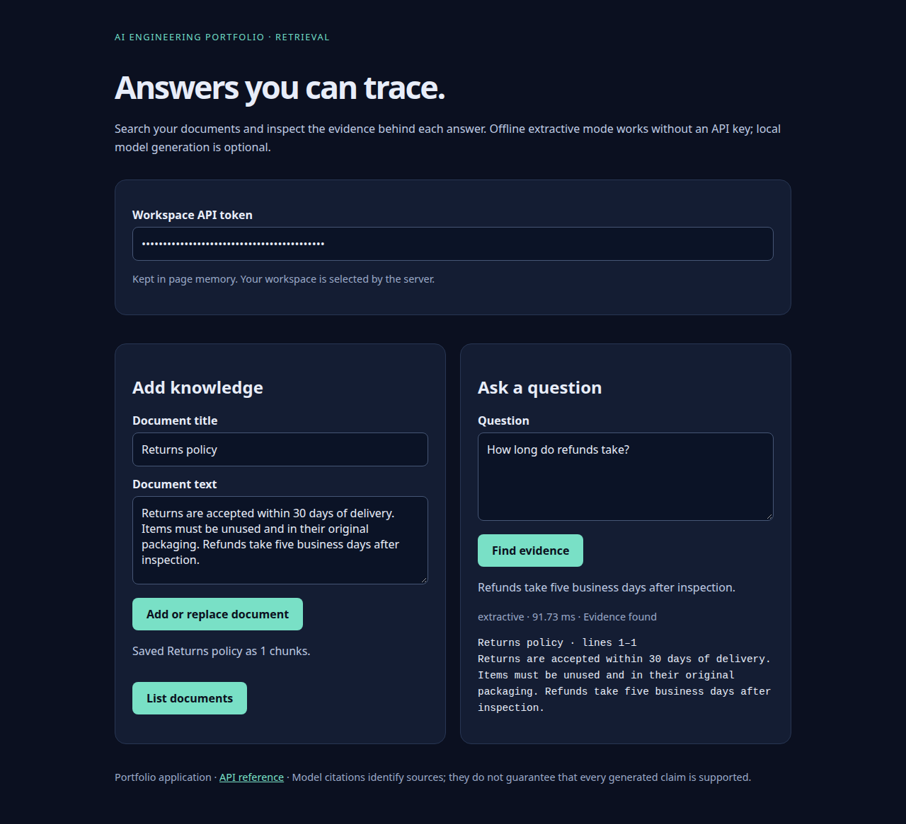
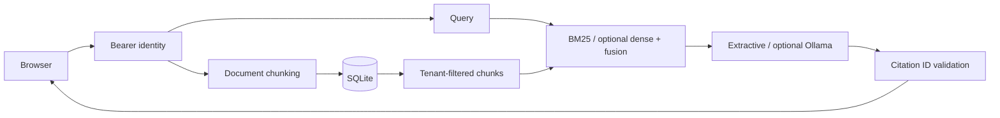

# CiteWise

**A document assistant whose answers link back to stored evidence.**





Upload plain-text documents, ask questions, and inspect source chunks with line ranges.
The browser demo works without paid APIs. Default answers are extracts from documents;
optional Ollama generation and Sentence Transformers embeddings demonstrate the RAG path.

## What this demonstrates

- Unicode-aware BM25 retrieval, character TF-IDF reranking, reciprocal-rank fusion, optional dense retrieval.
- Transactional document replacement, SQLite persistence, and server-enforced workspace isolation.
- Evidence-based abstention, validated citation IDs, provider error handling, and an accessible browser UI.
- Regression tests for tenant isolation, stale document replacement, persistence, Arabic text, and fabricated citations.

## Run locally

Python 3.11 or 3.12:

```bash
python -m venv .venv
source .venv/bin/activate
pip install -e '.[dev]'
cp .env.example .env
```

Replace the example tokens in `.env` with random values. Generate each using
`python -c 'import secrets; print(secrets.token_urlsafe(32))'`. Keep the identity JSON on one line.

```bash
uvicorn citewise.api:create_app --factory --env-file .env --host 127.0.0.1 --port 8000
```

Open <http://127.0.0.1:8000>, paste the customer token, save the prefilled policy,
and ask “How long do refunds take?” API documentation is at `/docs`.
Adding the same title replaces that workspace's document and removes its previous chunks.
Documents are shared within a workspace; separate workspaces cannot read each other's evidence.

## Optional model-backed RAG

Install and run [Ollama](https://docs.ollama.com/), then pull `qwen2.5:3b`.
Add these lines to `.env` and restart:

```dotenv
ANSWER_BACKEND=ollama
OLLAMA_URL=http://127.0.0.1:11434
OLLAMA_MODEL=qwen2.5:3b
```

For multilingual dense retrieval, run `pip install -e '.[semantic]'`, then set
`EMBEDDING_MODEL=sentence-transformers/paraphrase-multilingual-MiniLM-L12-v2` in `.env`.
This explicitly downloads a public embedding model at startup. The model can be large;
default retrieval does not download anything. Embeddings are recomputed per query in this
small-corpus implementation; build a persistent vector index before scaling.

## Validate

```bash
ruff check .
ruff format --check .
pytest --cov=src --cov-report=term-missing
python scripts/evaluate.py
```

The evaluation script is a **five-document synthetic retrieval fixture**, not evidence of
general retrieval quality. See [validation](docs/VALIDATION.md) for recorded results.

## Architecture



## Container

```bash
docker build -t citewise .
docker volume create citewise-data
docker run --rm -p 127.0.0.1:8000:8000 --env-file .env -e DB_PATH=/app/data/app.db -v citewise-data:/app/data citewise
```

The process runs as an unprivileged user. Use a named volume for persistence. Container
localhost differs from host localhost; configure a reachable trusted Ollama URL when needed.

## Limitations and honest CV claims

This is a locally validated portfolio app, not a hosted service. Static bearer identities
must be replaced or fronted with a real identity gateway for public use. Corpus loading and
ranking happen in memory per query. Citation ID validation prevents invented source IDs;
it cannot prove semantic faithfulness or eliminate prompt injection in generated prose.
The offline baseline abstains on absent lexical evidence and can miss paraphrases.

Suggested CV wording: “Built a tenant-isolated document assistant with BM25/dense retrieval,
source citations, transactional updates, and automated regression tests.” Add performance
numbers only after measuring a representative corpus.

MIT licensed. Original sample policy is synthetic. See [security](SECURITY.md),
[architecture decisions](docs/ARCHITECTURE.md), and [contributing](CONTRIBUTING.md).

## Browser validation

```bash
pip install -e '.[browser]'
playwright install chromium
python scripts/browser_smoke.py
```

This starts a disposable local server, exercises the UI, checks the 390 px mobile layout,
and saves screenshots. A matching browser check runs in GitHub Actions.

Validate the container with disposable volumes and accounts:

```bash
docker build -t citewise:portfolio .
python scripts/container_smoke.py
```
